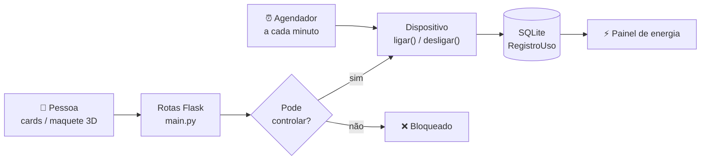
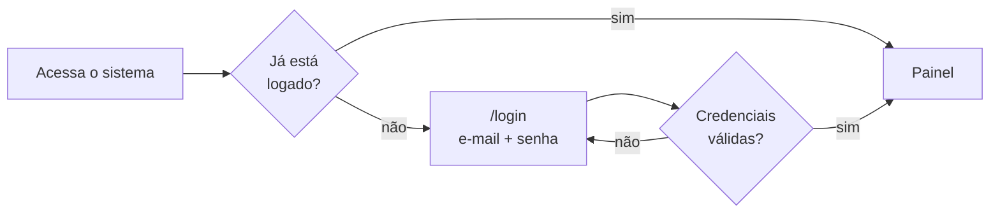
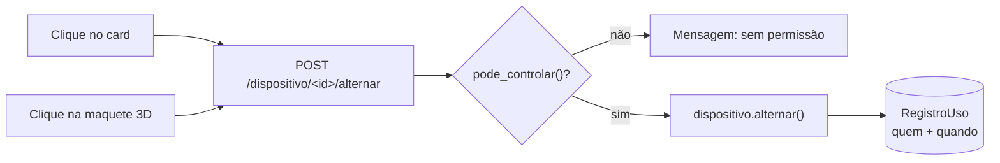
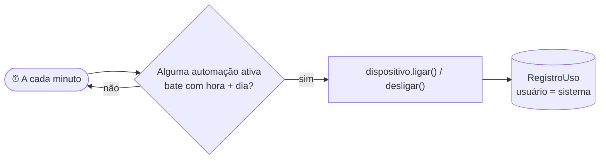
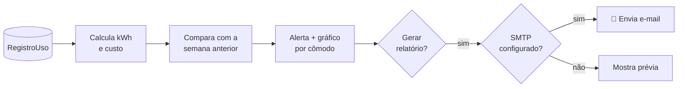
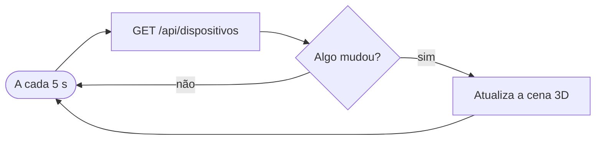

# Fluxograma da aplicação

Em vez de um diagrama gigante, dividimos o fluxo do PULSE2050 em partes
menores. Primeiro a visão geral e depois cada caminho importante.

## 1. Visão geral

Toda ação começa de **uma pessoa** (cards ou maquete 3D) ou do **agendador**,
passa pela mesma regra de permissão e termina registrada no banco.

## 2. Login

A sessão fica no Flask-Login, e há dois perfis: **Administrador** e
**Usuário Comum**.

## 3. Ligar / desligar um dispositivo

O caminho é o mesmo para o card e para a maquete 3D. Muda só a tela.

Na tela de detalhe, as outras ações seguem a mesma ideia: **valida antes de
salvar**.

| Ação | Rota | Validação |
|---|---|---|
| Intensidade da luz | `/dispositivo/<id>/intensidade` | número inteiro de 1 a 100 |
| Criar automação | `/dispositivo/<id>/automacao` | nome + horário HH:MM válido |
| Ativar/desativar automação | `/dispositivo/<id>/automacao/<id>/alternar` | permissão do perfil |
| Liberar para o usuário comum | `/dispositivo/<id>/permissao` | só administrador |

## 4. Automações (sem ninguém clicar)

O agendador chama os **mesmos métodos** que o botão da tela. Por isso a
automação também entra no cálculo de energia.

## 5. Energia e relatório

## 6. Maquete 3D sempre atualizada

Se uma automação ligar algo ou outra pessoa mexer em outra aba, a maquete
mostra a mudança em poucos segundos, sem recarregar a página.

## O que vale reparar

- **Uma regra só de permissão:** `pode_controlar()` vale para os cards, a
  maquete e as automações.
- **Nada é salvo sem validação:** intensidade, horário e login são conferidos
  antes de mexer no banco.
- **Pessoa e agendador geram o mesmo histórico:** o `RegistroUso` alimenta o
  painel de energia nos dois casos.
- **A maquete não tem lógica própria:** ela é só outra tela por cima das
  mesmas rotas.
