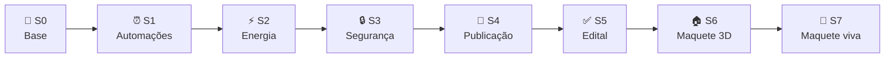
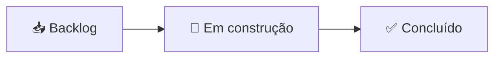

# 🗓️ O projeto em sprints

Aqui tá o PULSE2050 dividido nas etapas em que a gente foi construindo.
Cada sprint também virou um card no nosso
[Kanban](https://github.com/users/AndreDias123/projects/2), junto com as
publicações diárias do projeto.

**🧱 Sprint 0 — A base**
Montamos o banco com os dispositivos (herança e polimorfismo), o login com
dois perfis, o painel de energia e os primeiros testes automáticos.

**⏰ Sprint 1 — Automações sozinhas**
Colocamos um agendador rodando junto do Flask, que liga e desliga os
dispositivos no horário certo. Apanhamos um pouco do fuso horário até acertar.

**⚡ Sprint 2 — Energia mais inteligente**
Comparação com a semana anterior, projeção do mês e gráfico por cômodo. O
alerta chegou a mostrar +10794% de consumo — era falta de dado, corrigimos.

**🔒 Sprint 3 — Experiência e segurança**
Botão pra ativar/desativar automações, filtro por cômodo e proteção CSRF nos
formulários.

**🚀 Sprint 4 — Publicação**
Escrevemos o `PROCESS.md`, criamos o repositório e subimos tudo pro GitHub.

**✅ Sprint 5 — Conferindo o edital**
Revisamos item por item da categoria INTELLIGENCE e vimos que faltava o
fluxograma, então criamos o `FLUXOGRAMA.md`.

**🏠 Sprint 6 — Maquete 3D**
Fizemos a casa em 3D ligada ao banco: clicou no objeto, o dispositivo liga ou
desliga de verdade. Os 13 dispositivos aparecem na cena.

**🚗 Sprint 7 — Maquete mais viva**
A maquete ganhou carro entrando na garagem, moradores andando pela casa,
cômodos mobiliados e modo dia/noite.

## 📌 O gatilho no Kanban

Pra organizar as entregas, subimos o projeto em 10 publicações (o nosso
"gatilho") e acompanhamos tudo no quadro
[PULSE2050 — Gatilho do Projeto](https://github.com/users/AndreDias123/projects/2).

