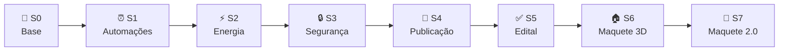
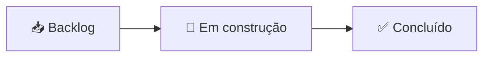

# 🗓️ PULSE2050 em Sprints

> Como o projeto cresceu, etapa por etapa. Cada sprint é um bloco real de
> trabalho — e cada uma também virou um card no nosso Kanban.

## 🧭 Linha do tempo

## 📋 Resumo das sprints

| Sprint | Foco | O que entregamos | 🐞 O que deu errado (e corrigimos) |
|:--:|---|---|---|
| **0** | Base | Dispositivos com herança, login com 2 perfis, energia, relatórios e 24 testes | Automações não disparavam sozinhas |
| **1** | Automações | Agendador (APScheduler) checando a cada minuto | Fuso horário UTC × local; agendador rodando 2× no modo debug |
| **2** | Energia | Comparação semanal, projeção do mês, alerta e gráfico por cômodo | Alerta mostrando **+10794%** por falta de dados — exigimos base mínima |
| **3** | Experiência e segurança | Liga/desliga de automações, filtro por cômodo, proteção CSRF | `timedelta` sem import — o smoke test pegou na hora |
| **4** | Publicação | `PROCESS.md`, `.gitignore`, repositório no GitHub | — |
| **5** | Edital | Conferência item a item da categoria INTELLIGENCE, `FLUXOGRAMA.md` | Faltava o fluxograma e a justificativa das estruturas de dados |
| **6** | Maquete 3D | Casa em Three.js ligada ao banco: clicar liga/desliga de verdade | 3 dispositivos sem objeto na cena — completamos os 13 |
| **7** | Maquete 2.0 | Carro que entra na garagem, moradores andando, cômodos mobiliados, dia/noite | Carro só anda com a porta 100% aberta, para não atravessá-la |

## 📌 O gatilho no Kanban

O projeto foi publicado em **10 entregas diárias** (o "gatilho"), cada uma um card no
quadro **[PULSE2050 — Gatilho do Projeto](https://github.com/users/AndreDias123/projects/2)**.

As 10 publicações e as sprints estão lá como cards, todos já em **Concluído** —
dá pra acompanhar o que entrou em cada dia e quem subiu cada parte.
